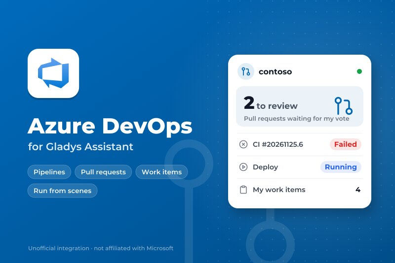
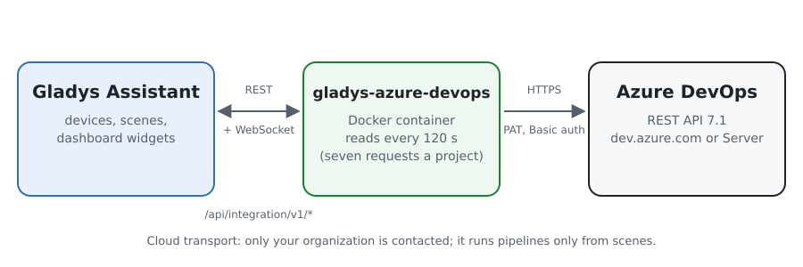
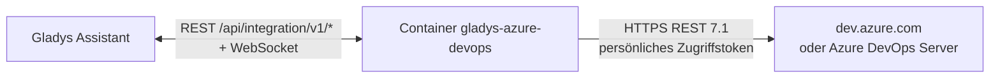
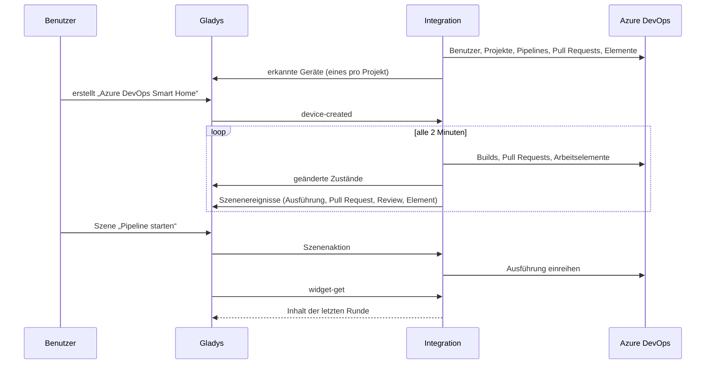
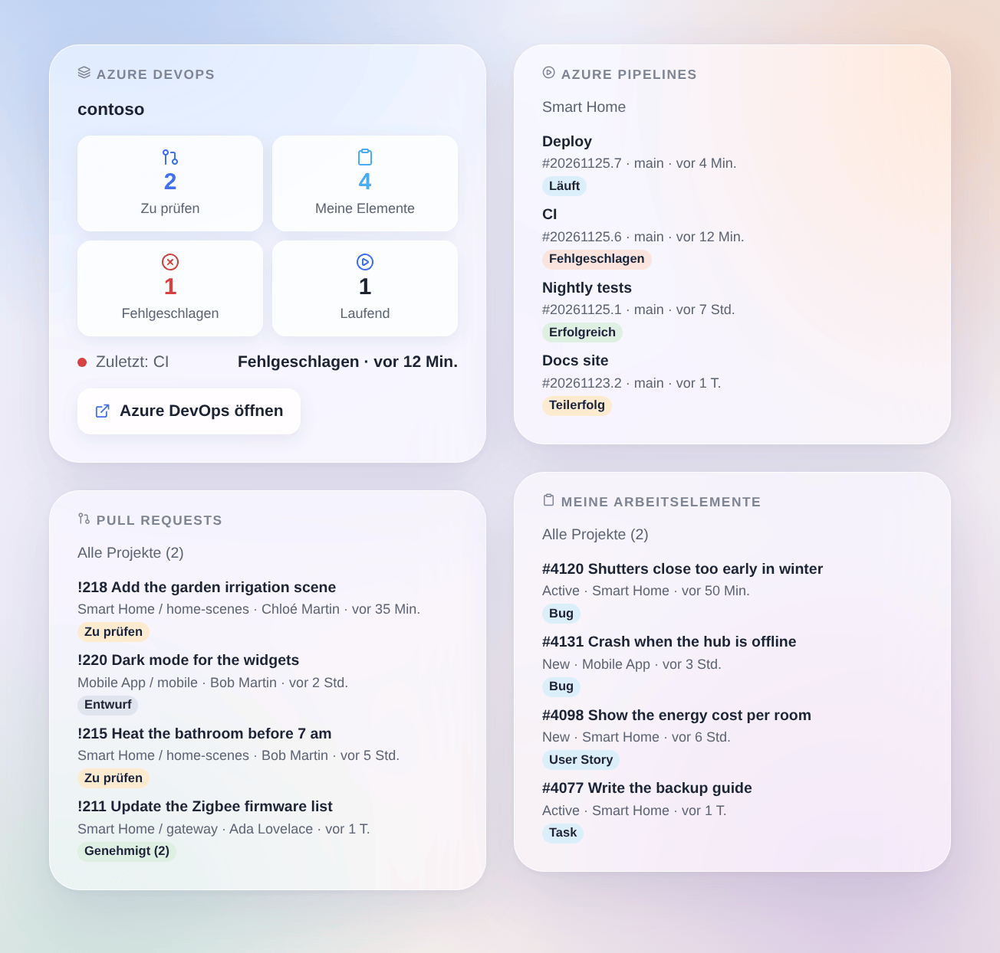

# Gladys Azure DevOps

[English](README.md) · [Français](README.fr.md) · **Deutsch** · [Español](README.es.md)

[](LICENSE)
[](https://github.com/William-De71/gladys-azure-devops/releases)
[](https://github.com/William-De71/gladys-azure-devops/actions/workflows/release.yml)
[](https://gladysassistant.com)



Externe [Gladys-Assistant](https://gladysassistant.com)-Integration für **[Azure DevOps](https://azure.microsoft.com/products/devops)**: verfolge die Projekte deiner Organisation in Gladys, ihre Pipeline-Ausführungen, Pull Requests und die dir zugewiesenen Arbeitselemente, in Szenen und auf dem Dashboard. Sie liest die offizielle REST-API von Azure DevOps (7.1) mit einem persönlichen Zugriffstoken, auf Azure DevOps Services oder Azure DevOps Server 2022.1 und neuer.

## Funktionen

- **Ein Gerät pro verfolgtem Projekt** (höchstens 20, standardmäßig alle Projekte): aktive Pull Requests, Pull Requests, die auf deine Stimme warten, deine offenen Arbeitselemente, fehlgeschlagene Pipelines, laufende Builds, die letzte beendete Ausführung und der neueste Pull Request.
- **5 Szenenauslöser**, **2 Szenenaktionen** und **4 Dashboard-Widgets** (siehe unten).
- Azure DevOps Services (dev.azure.com, visualstudio.com) oder eine Sammlung von **Azure DevOps Server**.
- Nur lesend, außer den Pipeline-Ausführungen, die du aus einer Szene startest. Ein Knopf in der Konfiguration testet das Token und nennt die fehlenden Bereiche.
- Überall vier Sprachen: Englisch, Französisch, Deutsch, Spanisch.

## Funktionsweise





Standardmäßig alle 2 Minuten (60 bis 3.600 Sekunden) liest die Integration den Benutzer des Tokens und die Projekte, dann jedes verfolgte Projekt mit sieben kleinen Anfragen: seine Pipelines mit ihren letzten Ausführungen, die beendeten und laufenden Builds, die aktiven und abgeschlossenen Pull Requests und die dir zugewiesenen offenen Arbeitselemente (WIQL-Abfrage mit `@Me`). Jede Runde wird mit der vorherigen verglichen, um die Szenenauslöser zu feuern; die erste Runde ist eine Referenz und löst nichts aus. Ein Teil, den das Token nicht lesen darf, wird weggelassen, und der fehlende Bereich wird im Status genannt.



### Transport

Nur Cloud (`"transports": ["cloud"]`): der Katalog zeigt das Cloud-Abzeichen. Die Integration erreicht die eingestellte Organisation per HTTPS mit deinem Token. Ein Azure DevOps Server in deinem Netz wird genauso über seine Adresse erreicht; es gibt keinen Knopf „Lokale Verbindung bevorzugen“.

## Geräte und Funktionen

| Funktion                                   | Kategorie / Typ          | Hinweis                                  |
| ------------------------------------------ | ------------------------ | ---------------------------------------- |
| Aktive Pull Requests, zu prüfen            | `counter-sensor/integer` | zu prüfen: warten auf deine Stimme       |
| Meine Arbeitselemente                      | `counter-sensor/integer` | offen, dem Benutzer zugewiesen           |
| Fehlgeschlagene Pipelines, laufende Builds | `counter-sensor/integer` | letzte Ausführung fehlgeschlagen / läuft |
| Letzte Ausführung                          | `text/text`              | `CI #20261125.6: Fehlgeschlagen`         |
| Neuester Pull Request                      | `text/text`              | `!218 Titel`                             |

`should_poll: false`: die Integration liest Azure DevOps mit ihrem eigenen Timer. Die externen IDs beruhen auf der Projekt-GUID: ein umbenanntes Projekt behält sein Gerät. Ein Zähler, den das Token nicht lesen konnte, wird nicht veröffentlicht, nie auf 0 gesetzt.

## Szenenauslöser, Aktionen und Widgets



**Auslöser** (Filter: das Projektgerät)

- **Pipeline-Ausführung beendet**: Filter nach Ergebnis, Pipeline-Name und Branch.
- **Pull Request erstellt**: Filter nach Repository und Zielbranch (mit dem Kennzeichen `draft`).
- **Review angefordert**: ein Pull Request wartet auf deine Stimme.
- **Pull Request abgeschlossen**: in seinen Zielbranch gemergt.
- **Arbeitselement zugewiesen**: Filter nach Typ (Bug, User Story…).

Jedes Ereignis enthält das Projekt, das Element (Nummer, Titel, Autor oder Typ, Link) und einen Satz `summary` für eine Nachricht.

**Aktionen**: Projekt lesen (Zähler, letzte Ausführung, neuester Pull Request, `summary`) und Pipeline starten (nach Name, `Ordner\Name` oder ID, auf einem Branch oder ihrem Standardbranch; braucht den Bereich Build (Read & execute)).

**Widgets**: **Azure DevOps** (zu prüfen, meine Elemente, fehlgeschlagen, laufend, letzte Ausführung, Link), **Azure Pipelines** (die letzte Ausführung jeder Pipeline eines Projekts), **Pull Requests** (alle, wartend auf deine Stimme oder deine) und **Meine Arbeitselemente**.

**Beispiele**

- Wenn **die CI von `main` fehlschlägt** → ein rotes Licht im Büro und eine Benachrichtigung mit dem `summary`.
- Wenn **dein Review angefordert wird** → eine Nachricht mit dem Link auf dein Handy.
- Jeden Abend um 18 Uhr → **die Pipeline „Nightly tests“ starten** und ihre Ausführungsnummer senden.

## Voraussetzungen

- Gladys Assistant **5.3.0** oder neuer (Katalog-Schlüsselwörter). Ältere Instanzen können die Integration nicht installieren.
- Eine Azure-DevOps-Organisation oder eine Sammlung von Azure DevOps Server **2022.1** oder neuer (API 7.1).
- Ein persönliches Zugriffstoken mit **Build (Read & execute)**, **Code (Read)**, **Work Items (Read)** und **Project and Team (Read)**.

## Installation

- **Aus dem Store** von Gladys (Integrationen → Externe Integrationen), mit einem Klick, sobald indexiert.
- **Über die URL des Repositorys**: `https://github.com/William-De71/gladys-azure-devops`.
- **Entwicklermodus**: baue das Image lokal (`docker build -t gladys-azure-devops .`) und installiere es aus Gladys.

## Konfiguration

| Feld                       | Standard    | Aufgabe                                                                        |
| -------------------------- | ----------- | ------------------------------------------------------------------------------ |
| Organisation               | —           | `contoso`, ein dev.azure.com-Link oder `https://server/tfs/DefaultCollection`. |
| Persönliches Zugriffstoken | —           | Das Token, mit den oben genannten Bereichen (geheim).                          |
| Projekte                   | alle        | Namen durch Kommas getrennt; höchstens 20.                                     |
| Abfrageintervall (s)       | 120         | 60 bis 3.600 Sekunden; auch die Reaktionszeit der Szenenauslöser.              |
| Sprache der Texte          | automatisch | Gerätenamen, Zusammenfassungen und Ausgaben der Szenen.                        |

## Verwendung

1. Öffne in Azure DevOps **Benutzereinstellungen → Persönliche Zugriffstoken** und füge ein Token für die Organisation mit den oben genannten Bereichen hinzu.
2. Gib die Organisation, das Token und auf Wunsch die Projekte ein und speichere; drücke **Verbindung testen**.
3. Erstelle im Tab **Erkennung** die Geräte „Azure DevOps …“.
4. Füge die Widgets **Azure DevOps**, **Azure Pipelines**, **Pull Requests** und **Meine Arbeitselemente** hinzu und baue Szenen mit den Auslösern oben.

## Entwicklung

```bash
npm install
npm test                       # node --test, nie mit Netzwerkzugriff
npm run lint && npm run format:check
npx github:GladysAssistant/integration-store . --skip-image-check
scripts/build-cover.sh         # cover.jpg aus docs/assets/cover.svg
docs/illustrations/render.sh   # docs/assets/widgets.<sprache>.png
node .github/scripts/release.mjs next
```

Lokal liest das SDK `GLADYS_HOST_API_URL`, `GLADYS_INTEGRATION_TOKEN` und `GLADYS_INTEGRATION_SELECTOR`; `DEBUG=gladys-integration-sdk` zeigt die SDK-Protokolle. Die Tests nutzen eine falsche Organisation (`test/helpers/fixtures.js`) nach der [REST-API-Referenz](https://learn.microsoft.com/rest/api/azure/devops/) und den Antworten einer öffentlichen Organisation. Die Regeln des Projekts stehen in [CLAUDE.md](CLAUDE.md).

## Release-Prozess


Jeder Merge auf `main` startet die CI und berechnet dann die Version aus den [Conventional Commits](https://www.conventionalcommits.org/) seit dem letzten Tag: `feat` → Minor, `fix` / `perf` → Patch, `!` oder `BREAKING CHANGE` → Major (ein Minor unter 1.0.0); `docs`, `chore`, `ci`, `test`, `style`, `refactor`, `build` allein veröffentlichen nichts. Der Changelog-Abschnitt wird erzeugt, der Tag gepusht, das Multi-Architektur-Image gebaut, dann erhält `main` den Release-Commit, das GitHub-Release wird erstellt und ein letzter Job prüft das öffentliche Image, den Store-Validator und das Topic.

- Der Titel des Pull Requests wird zum Squash-Commit und dann zur Changelog-Zeile: schreibe ihn auf Englisch, für die Nutzer (`pr-title.yml` prüft ihn). Bearbeite `CHANGELOG.md` nie von Hand.
- 1.0.0 ist eine Entscheidung: Actions → Release → Run workflow mit `release-as: 1.0.0`. `dry-run` zeigt Version und Notizen, ohne etwas zu veröffentlichen.
- **Geschützter Branch**: Rulesets verlangen einen Pull Request auf `main` und sperren die Tags `v*`; nur der Maintainer und Deploy Keys kommen durch. Das Release pusht mit dem Deploy Key der Umgebung `release` (Secret `RELEASE_DEPLOY_KEY`, nur `main`): ein Lauf aus einem anderen Branch erhält ihn nie. `build.yml` und `github-release.yml` starten nicht bei einem Tag: das Release ruft sie auf, oder starte sie von Hand (Actions → Run workflow, mit `version` für das Image), um ein Release abzuschließen.
- Mache nach dem ersten Release das `ghcr.io`-Paket öffentlich (Package settings → Change visibility), sonst kann Gladys es nicht laden.

## Fehlerbehebung

Siehe [docs/de.md](docs/de.md#fehlerbehebung). Melde Probleme mit den Versionen von Gladys und der Integration und den Protokollen der Integration (nie mit deinem Token).

## Mitwirken

Issues und Pull Requests sind willkommen. Führe `npm run format:check && npm run lint && npm test` vor einem Pull Request aus und lass alle externen IDs und gespeicherten Schlüssel unverändert (siehe [CLAUDE.md](CLAUDE.md)).

## Sicherheit

Siehe [SECURITY.md](SECURITY.md): melde Schwachstellen vertraulich. Das Token ist ein `secret`-Feld von Gladys, wird nur an die eingestellte Organisation gesendet, in einem Basic-Header per HTTPS, und nie protokolliert. Gib ihm nur die oben genannten Bereiche: ohne Build (Read & execute) kann die Integration nichts starten. Sie läuft als Nicht-Root-Benutzer in ihrem Container.

## Kommende Screenshots

Die Bilder oben sind Illustrationen, keine Screenshots. Echte Screenshots kommen nach `docs/assets/screenshots/` (PNG, 1280 × 800): `configuration.png`, `discovery.png`, `device.png`, `scene.png`.

## Lizenz

[Apache-Lizenz 2.0](LICENSE) — siehe auch [NOTICE](NOTICE). Azure DevOps ist eine Marke der Microsoft-Unternehmensgruppe; diese Integration steht in keiner Verbindung zu Microsoft. Danke an die Dokumentation und das SDK von Gladys und an Microsoft für die Referenz der REST-API von Azure DevOps.
