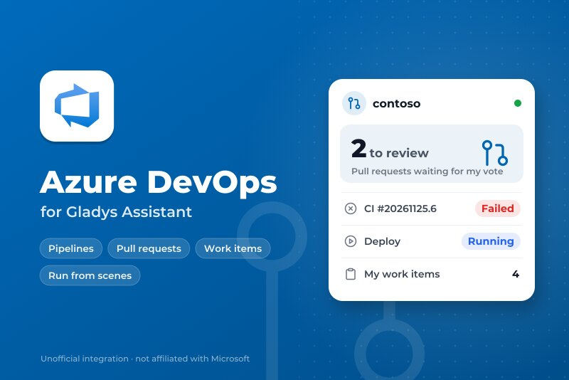
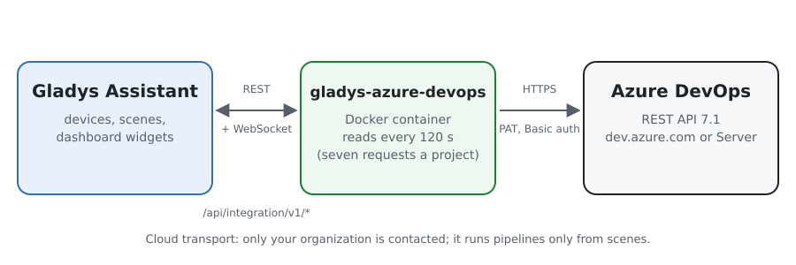
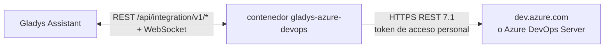
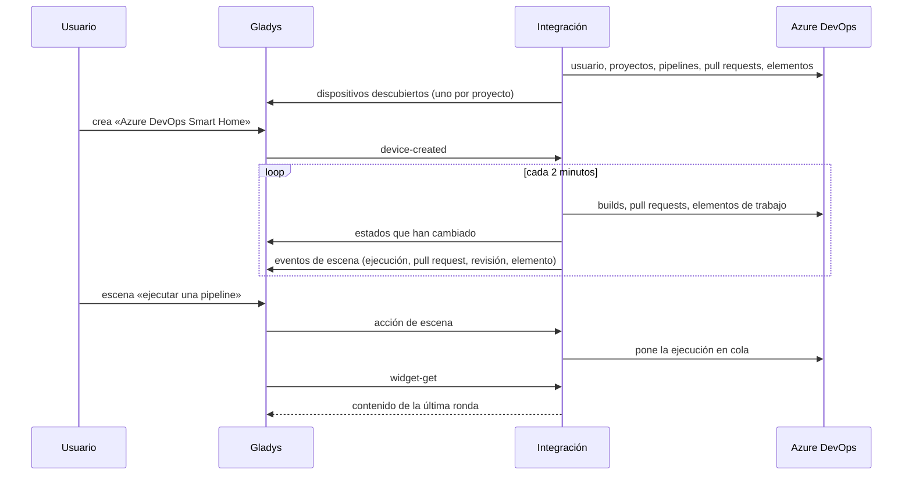
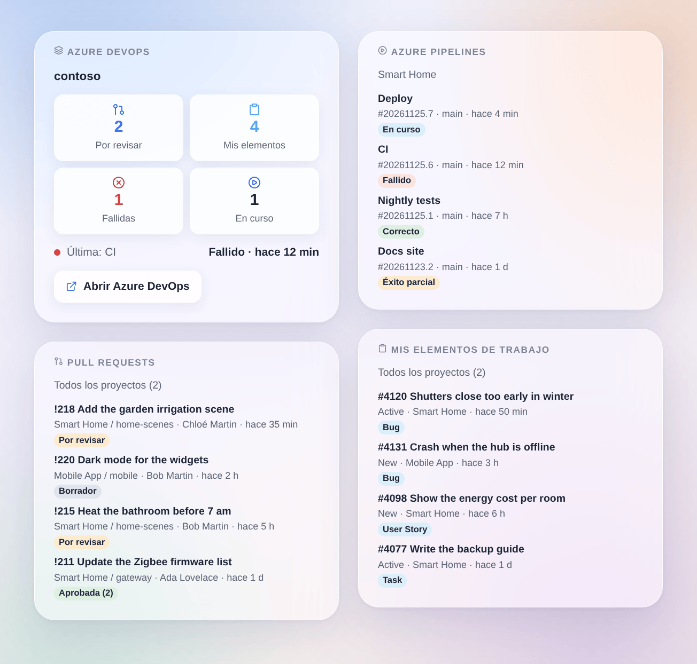

# Gladys Azure DevOps

[English](README.md) · [Français](README.fr.md) · [Deutsch](README.de.md) · **Español**

[](LICENSE)
[](https://github.com/William-De71/gladys-azure-devops/releases)
[](https://github.com/William-De71/gladys-azure-devops/actions/workflows/release.yml)
[](https://gladysassistant.com)



Integración externa de [Gladys Assistant](https://gladysassistant.com) para **[Azure DevOps](https://azure.microsoft.com/products/devops)**: siga en Gladys los proyectos de su organización, sus ejecuciones de pipelines, sus pull requests y los elementos de trabajo que tiene asignados, en las escenas y en el panel. Lee la API REST oficial de Azure DevOps (7.1) con un token de acceso personal, en Azure DevOps Services o Azure DevOps Server 2022.1 y posteriores.

## Funciones

- **Un dispositivo por proyecto seguido** (20 como máximo, todos los proyectos por defecto): pull requests activas, pull requests que esperan su voto, sus elementos de trabajo abiertos, pipelines fallidas, builds en curso, la última ejecución terminada y la pull request más reciente.
- **5 disparadores de escena**, **2 acciones de escena** y **4 widgets del panel** (abajo).
- Azure DevOps Services (dev.azure.com, visualstudio.com) o una colección de **Azure DevOps Server**.
- Solo lectura, salvo las ejecuciones de pipeline que lance desde una escena. Un botón de la configuración prueba el token e indica los ámbitos que le faltan.
- Cuatro idiomas en todo: inglés, francés, alemán y español.

## Funcionamiento





Cada 2 minutos por defecto (de 60 a 3600 segundos), la integración lee el usuario del token y los proyectos, y luego cada proyecto seguido con siete pequeñas peticiones: sus pipelines con sus últimas ejecuciones, las builds terminadas y en curso, las pull requests activas y completadas, y los elementos de trabajo abiertos que tiene asignados (consulta WIQL con `@Me`). Cada ronda se compara con la anterior para los disparadores de escena; la primera sirve de referencia y no dispara nada. Una parte que el token no puede leer se omite, y el ámbito que falta se indica en el estado.



### Transporte

Solo nube (`"transports": ["cloud"]`): el catálogo muestra la insignia de nube. La integración contacta con la organización configurada por HTTPS con su token. Un Azure DevOps Server de su red se alcanza igual, en su dirección; no hay botón «Preferir la conexión local».

## Dispositivos y funciones

| Función                             | Categoría / tipo         | Nota                                |
| ----------------------------------- | ------------------------ | ----------------------------------- |
| Pull requests activas, por revisar  | `counter-sensor/integer` | por revisar: esperan su voto        |
| Mis elementos de trabajo            | `counter-sensor/integer` | abiertos, asignados al usuario      |
| Pipelines fallidas, builds en curso | `counter-sensor/integer` | última ejecución fallida / en curso |
| Última ejecución                    | `text/text`              | `CI #20261125.6: Fallido`           |
| Última pull request                 | `text/text`              | `!218 Título`                       |

`should_poll: false`: la integración lee Azure DevOps con su propio temporizador. Los identificadores externos se basan en el GUID del proyecto: cambiar el nombre de un proyecto conserva su dispositivo. Un contador que el token no ha podido leer no se publica, nunca se pone a 0.

## Disparadores, acciones de escena y widgets



**Disparadores** (filtro: el dispositivo del proyecto)

- **Ejecución de pipeline terminada**: filtros por resultado, nombre de la pipeline y rama.
- **Pull request creada**: filtros por repositorio y rama de destino (con su indicador `draft`).
- **Revisión solicitada**: una pull request espera su voto.
- **Pull request completada**: fusionada en su rama de destino.
- **Elemento de trabajo asignado**: filtro por tipo (Bug, User Story…).

Cada evento lleva el proyecto, el elemento (número, título, autor o tipo, enlace) y una frase `summary` lista para un mensaje.

**Acciones**: leer un proyecto (contadores, última ejecución, última pull request, `summary`) y ejecutar una pipeline (por nombre, `carpeta\nombre` o identificador, en una rama o en su rama por defecto; necesita el ámbito Build (Read & execute)).

**Widgets**: **Azure DevOps** (por revisar, mis elementos, fallidas, en curso, última ejecución, enlace), **Azure Pipelines** (la última ejecución de cada pipeline de un proyecto), **Pull requests** (todas, las que esperan su voto o las suyas) y **Mis elementos de trabajo**.

**Ejemplos**

- Cuando **la CI de `main` falla** → una luz roja en el despacho y una notificación con el `summary`.
- Cuando **se solicita su revisión** → un mensaje en su móvil con el enlace.
- Cada tarde a las 18 h → **ejecutar la pipeline «Nightly tests»** y enviar su número de ejecución.

## Requisitos

- Gladys Assistant **5.3.0** o posterior (palabras clave del catálogo). Las instancias más antiguas no pueden instalar la integración.
- Una organización de Azure DevOps, o una colección de Azure DevOps Server **2022.1** o posterior (API 7.1).
- Un token de acceso personal con **Build (Read & execute)**, **Code (Read)**, **Work Items (Read)** y **Project and Team (Read)**.

## Instalación

- **Desde la tienda** de Gladys (Integraciones → Integraciones externas), con un clic, una vez indexada.
- **Desde la URL del repositorio**: `https://github.com/William-De71/gladys-azure-devops`.
- **Modo desarrollador**: construya la imagen en local (`docker build -t gladys-azure-devops .`) e instálela desde Gladys.

## Configuración

| Campo                    | Por defecto | Función                                                                           |
| ------------------------ | ----------- | --------------------------------------------------------------------------------- |
| Organización             | —           | `contoso`, un enlace de dev.azure.com o `https://servidor/tfs/DefaultCollection`. |
| Token de acceso personal | —           | El token, con los ámbitos indicados arriba (secreto).                             |
| Proyectos                | todos       | Nombres separados por comas; 20 como máximo.                                      |
| Intervalo de lectura (s) | 120         | De 60 a 3600 segundos; también el retardo de los disparadores de escena.          |
| Idioma de los textos     | automático  | Nombres de los dispositivos, resúmenes y salidas de las escenas.                  |

## Uso

1. En Azure DevOps, abra **Configuración de usuario → Tokens de acceso personal** y añada un token para la organización con los ámbitos indicados arriba.
2. Introduzca la organización, el token y, si lo desea, los proyectos, y guarde; pulse **Probar la conexión**.
3. En la pestaña **Descubrimiento**, cree los dispositivos «Azure DevOps …».
4. Añada los widgets **Azure DevOps**, **Azure Pipelines**, **Pull requests** y **Mis elementos de trabajo**, y cree escenas con los disparadores anteriores.

## Desarrollo

```bash
npm install
npm test                       # node --test, nunca accede a la red
npm run lint && npm run format:check
npx github:GladysAssistant/integration-store . --skip-image-check
scripts/build-cover.sh         # cover.jpg desde docs/assets/cover.svg
docs/illustrations/render.sh   # docs/assets/widgets.<idioma>.png
node .github/scripts/release.mjs next
```

En local, el SDK lee `GLADYS_HOST_API_URL`, `GLADYS_INTEGRATION_TOKEN` y `GLADYS_INTEGRATION_SELECTOR`; `DEBUG=gladys-integration-sdk` muestra los registros del SDK. Las pruebas usan una organización falsa (`test/helpers/fixtures.js`) basada en la [referencia de la API REST](https://learn.microsoft.com/rest/api/azure/devops/) y en las respuestas de una organización pública. Las reglas del proyecto están en [CLAUDE.md](CLAUDE.md).

## Proceso de publicación


Cada fusión en `main` lanza la CI y luego calcula la versión a partir de los [Conventional Commits](https://www.conventionalcommits.org/) desde la última etiqueta: `feat` → menor, `fix` / `perf` → parche, `!` o `BREAKING CHANGE` → mayor (una menor por debajo de 1.0.0); `docs`, `chore`, `ci`, `test`, `style`, `refactor`, `build` solos no publican nada. Se genera la sección del changelog, se sube la etiqueta, se construye la imagen multiarquitectura, luego `main` recibe el commit de publicación, se crea la GitHub Release y un último job comprueba la imagen pública, el validador de la tienda y el topic.

- El título de la pull request se convierte en el commit squash y luego en la línea del changelog: escríbalo en inglés, para el usuario (`pr-title.yml` lo comprueba). No edite nunca `CHANGELOG.md` a mano.
- 1.0.0 es una decisión: Actions → Release → Run workflow con `release-as: 1.0.0`. `dry-run` muestra la versión y las notas sin publicar nada.
- **Rama protegida**: los rulesets exigen una pull request en `main` y bloquean las etiquetas `v*`; solo pasan el mantenedor y las deploy keys. La publicación sube con la deploy key del entorno `release` (secreto `RELEASE_DEPLOY_KEY`, solo `main`): una ejecución desde otra rama nunca la obtiene. `build.yml` y `github-release.yml` no arrancan con una etiqueta: la publicación los llama, o láncelos a mano (Actions → Run workflow, con `version` para la imagen) para terminar una publicación.
- Tras la primera publicación, haga público el paquete `ghcr.io` (Package settings → Change visibility); si no, Gladys no puede descargarlo.

## Solución de problemas

Vea [docs/es.md](docs/es.md#solución-de-problemas). Informe de los problemas con las versiones de Gladys y de la integración y los registros de la integración (nunca su token).

## Contribuir

Las issues y pull requests son bienvenidas. Ejecute `npm run format:check && npm run lint && npm test` antes de abrir una pull request y mantenga sin cambios los identificadores externos y las claves guardadas (vea [CLAUDE.md](CLAUDE.md)).

## Seguridad

Vea [SECURITY.md](SECURITY.md): informe de las vulnerabilidades en privado. El token es un campo `secret` de Gladys, enviado solo a la organización configurada, en una cabecera Basic por HTTPS, y nunca se escribe en los registros. Concédale solo los ámbitos indicados: sin Build (Read & execute), la integración no puede lanzar nada. Se ejecuta con un usuario no root, en su contenedor.

## Capturas pendientes

Las imágenes anteriores son ilustraciones, no capturas de pantalla. Las capturas reales irán en `docs/assets/screenshots/` (PNG, 1280 × 800): `configuration.png`, `discovery.png`, `device.png`, `scene.png`.

## Licencia

[Licencia Apache 2.0](LICENSE) — vea también [NOTICE](NOTICE). Azure DevOps es una marca del grupo de empresas Microsoft; esta integración no está afiliada a Microsoft. Gracias a la documentación y al SDK de Gladys, y a Microsoft por la referencia de la API REST de Azure DevOps.
