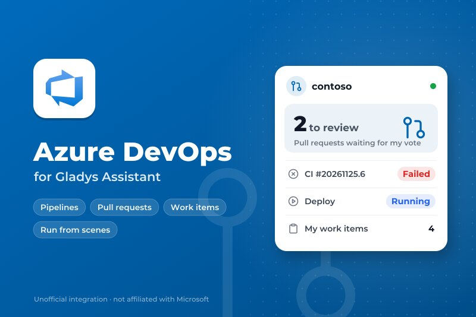
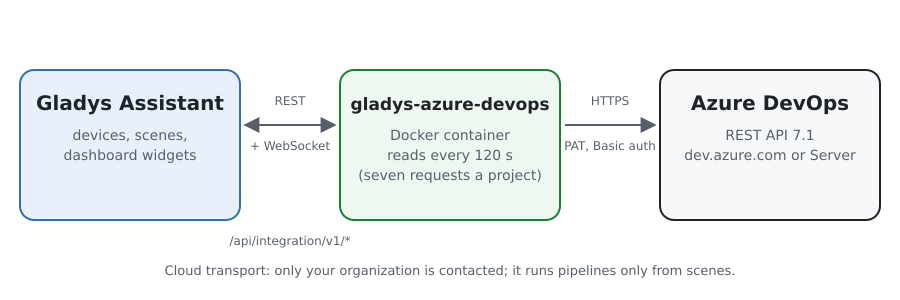
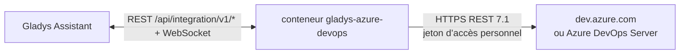
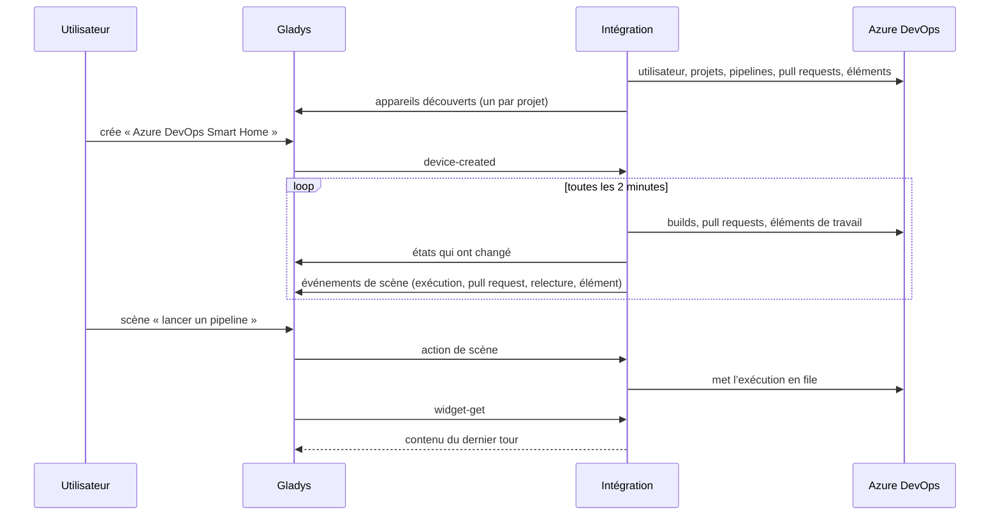
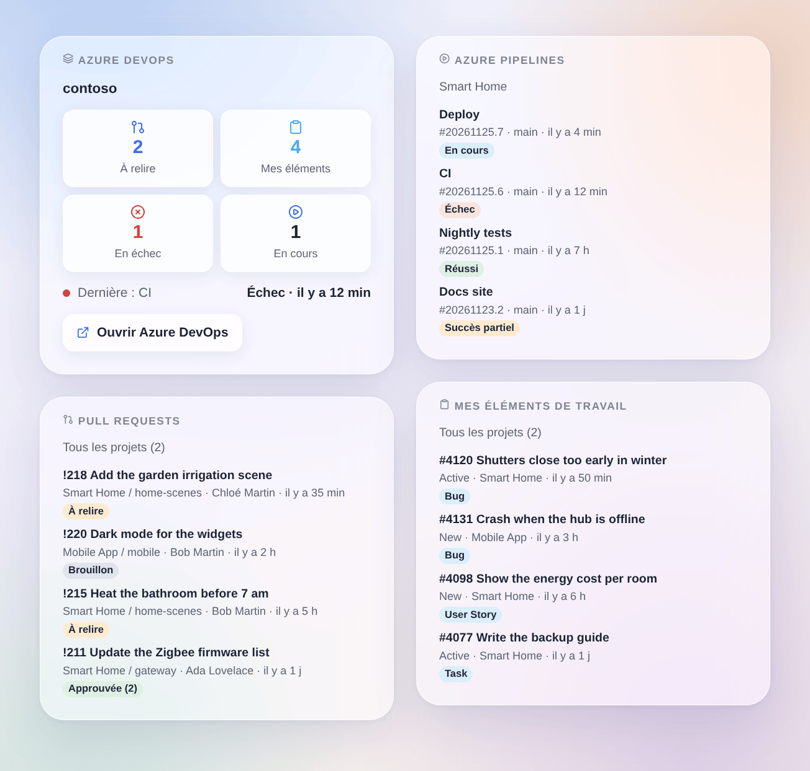

# Gladys Azure DevOps

[English](README.md) · **Français** · [Deutsch](README.de.md) · [Español](README.es.md)

[](LICENSE)
[](https://github.com/William-De71/gladys-azure-devops/releases)
[](https://github.com/William-De71/gladys-azure-devops/actions/workflows/release.yml)
[](https://gladysassistant.com)



Intégration externe [Gladys Assistant](https://gladysassistant.com) pour **[Azure DevOps](https://azure.microsoft.com/products/devops)** : suivez dans Gladys les projets de votre organisation, leurs exécutions de pipelines, leurs pull requests et les éléments de travail qui vous sont assignés, dans les scènes et sur le tableau de bord. Elle lit l’API REST officielle d’Azure DevOps (7.1) avec un jeton d’accès personnel, sur Azure DevOps Services ou Azure DevOps Server 2022.1 et plus récent.

## Fonctionnalités

- **Un appareil par projet suivi** (20 au plus, tous les projets par défaut) : pull requests actives, pull requests en attente de votre vote, vos éléments de travail ouverts, pipelines en échec, builds en cours, la dernière exécution terminée et la pull request la plus récente.
- **5 déclencheurs de scène**, **2 actions de scène** et **4 widgets de tableau de bord** (ci-dessous).
- Azure DevOps Services (dev.azure.com, visualstudio.com) ou une collection **Azure DevOps Server**.
- Lecture seule, sauf les exécutions de pipeline lancées depuis une scène. Un bouton de la configuration teste le jeton et nomme les étendues qui lui manquent.
- Quatre langues partout : anglais, français, allemand, espagnol.

## Fonctionnement





Toutes les 2 minutes par défaut (de 60 à 3 600 secondes), l’intégration lit l’utilisateur du jeton et les projets, puis chaque projet suivi en sept petites requêtes : ses pipelines et leurs dernières exécutions, les builds terminés et en cours, les pull requests actives et terminées, et les éléments de travail ouverts qui vous sont assignés (requête WIQL avec `@Me`). Chaque tour est comparé au précédent pour les déclencheurs de scène ; le premier sert de référence et ne déclenche rien. Une partie que le jeton ne peut pas lire est omise, et l’étendue qui manque est nommée dans le statut.



### Transport

Cloud uniquement (`"transports": ["cloud"]`) : le catalogue affiche le badge cloud. L’intégration contacte l’organisation configurée en HTTPS avec votre jeton. Un Azure DevOps Server de votre réseau est joint de la même façon, à son adresse ; il n’y a pas de bouton « Préférer la connexion locale ».

## Appareils et fonctionnalités

| Fonctionnalité                      | Catégorie / type         | Remarque                               |
| ----------------------------------- | ------------------------ | -------------------------------------- |
| Pull requests actives, à relire     | `counter-sensor/integer` | à relire : en attente de votre vote    |
| Mes éléments de travail             | `counter-sensor/integer` | ouverts, assignés à l’utilisateur      |
| Pipelines en échec, builds en cours | `counter-sensor/integer` | dernière exécution en échec / en cours |
| Dernière exécution                  | `text/text`              | `CI #20261125.6: Échec`                |
| Dernière pull request               | `text/text`              | `!218 Titre`                           |

`should_poll: false` : l’intégration lit Azure DevOps avec son propre minuteur. Les identifiants externes reposent sur le GUID du projet : renommer un projet garde son appareil. Un compteur que le jeton n’a pas pu lire n’est pas publié, jamais mis à 0.

## Déclencheurs, actions de scène et widgets



**Déclencheurs** (filtre : l’appareil du projet)

- **Exécution de pipeline terminée** : filtres sur le résultat, le nom du pipeline et la branche.
- **Pull request créée** : filtres sur le dépôt et la branche cible (avec son indicateur `draft`).
- **Relecture demandée** : une pull request attend votre vote.
- **Pull request terminée** : fusionnée dans sa branche cible.
- **Élément de travail assigné** : filtre sur le type (Bug, User Story…).

Chaque événement porte le projet, l’élément (numéro, titre, auteur ou type, lien) et une phrase `summary` prête pour un message.

**Actions** : lire un projet (compteurs, dernière exécution, dernière pull request, `summary`) et lancer un pipeline (par nom, `dossier\nom` ou identifiant, sur une branche ou sa branche par défaut ; étendue Build (Read & execute) nécessaire).

**Widgets** : **Azure DevOps** (à relire, mes éléments, en échec, en cours, dernière exécution, lien), **Azure Pipelines** (la dernière exécution de chaque pipeline d’un projet), **Pull requests** (toutes, en attente de votre vote, ou les vôtres) et **Mes éléments de travail**.

**Exemples**

- Quand **la CI de `main` échoue** → une lumière rouge au bureau et une notification avec le `summary`.
- Quand **votre relecture est demandée** → un message sur votre téléphone avec le lien.
- Chaque soir à 18 h → **lancer le pipeline « Nightly tests »**, puis envoyer son numéro d’exécution.

## Prérequis

- Gladys Assistant **5.3.0** ou plus récent (mots-clés du catalogue). Les instances plus anciennes ne peuvent pas installer l’intégration.
- Une organisation Azure DevOps, ou une collection Azure DevOps Server **2022.1** ou plus récent (API 7.1).
- Un jeton d’accès personnel avec **Build (Read & execute)**, **Code (Read)**, **Work Items (Read)** et **Project and Team (Read)**.

## Installation

- **Depuis le store** de Gladys (Intégrations → Intégrations externes), en un clic, une fois indexée.
- **Depuis l’URL du dépôt** : `https://github.com/William-De71/gladys-azure-devops`.
- **Mode développeur** : construisez l’image en local (`docker build -t gladys-azure-devops .`) et installez-la depuis Gladys.

## Configuration

| Champ                     | Défaut      | Rôle                                                                          |
| ------------------------- | ----------- | ----------------------------------------------------------------------------- |
| Organisation              | —           | `contoso`, un lien dev.azure.com, ou `https://serveur/tfs/DefaultCollection`. |
| Jeton d’accès personnel   | —           | Le jeton, avec les étendues ci-dessus (secret).                               |
| Projets                   | tous        | Noms séparés par des virgules ; 20 au plus.                                   |
| Intervalle de lecture (s) | 120         | De 60 à 3 600 secondes ; aussi le délai des déclencheurs de scène.            |
| Langue des textes         | automatique | Noms des appareils, résumés et sorties des scènes.                            |

## Utilisation

1. Dans Azure DevOps, ouvrez **Paramètres utilisateur → Jetons d’accès personnels** et ajoutez un jeton pour l’organisation avec les étendues ci-dessus.
2. Saisissez l’organisation, le jeton et, si vous le souhaitez, les projets, puis enregistrez ; appuyez sur **Tester la connexion**.
3. Dans l’onglet **Découverte**, créez les appareils « Azure DevOps … ».
4. Ajoutez les widgets **Azure DevOps**, **Azure Pipelines**, **Pull requests** et **Mes éléments de travail**, et construisez des scènes avec les déclencheurs ci-dessus.

## Développement

```bash
npm install
npm test                       # node --test, ne touche jamais le réseau
npm run lint && npm run format:check
npx github:GladysAssistant/integration-store . --skip-image-check
scripts/build-cover.sh         # cover.jpg depuis docs/assets/cover.svg
docs/illustrations/render.sh   # docs/assets/widgets.<langue>.png
node .github/scripts/release.mjs next
```

En local, le SDK lit `GLADYS_HOST_API_URL`, `GLADYS_INTEGRATION_TOKEN` et `GLADYS_INTEGRATION_SELECTOR` ; `DEBUG=gladys-integration-sdk` affiche les journaux du SDK. Les tests servent une fausse organisation (`test/helpers/fixtures.js`) calquée sur la [référence de l’API REST](https://learn.microsoft.com/rest/api/azure/devops/) et les réponses d’une organisation publique. Les règles du projet sont dans [CLAUDE.md](CLAUDE.md).

## Processus de release


Chaque fusion sur `main` lance la CI, puis calcule la version à partir des [Conventional Commits](https://www.conventionalcommits.org/) depuis le dernier tag : `feat` → mineure, `fix` / `perf` → correctif, `!` ou `BREAKING CHANGE` → majeure (une mineure sous 1.0.0) ; `docs`, `chore`, `ci`, `test`, `style`, `refactor`, `build` seuls ne publient rien. La section du changelog est générée, le tag poussé, l’image multi-architecture construite, puis `main` reçoit le commit de release, la GitHub Release est créée et un dernier job vérifie l’image publique, le validateur du store et le topic.

- Le titre de la pull request devient le commit squash, puis la ligne du changelog : écrivez-le en anglais, pour l’utilisateur (`pr-title.yml` le vérifie). N’éditez jamais `CHANGELOG.md` à la main.
- 1.0.0 est une décision : Actions → Release → Run workflow avec `release-as: 1.0.0`. `dry-run` affiche la version et les notes sans rien publier.
- **Branche protégée** : des rulesets exigent une pull request sur `main` et verrouillent les tags `v*` ; seuls le mainteneur et les deploy keys passent. La release pousse avec la deploy key de l’environnement `release` (secret `RELEASE_DEPLOY_KEY`, `main` seulement) : un run lancé depuis une autre branche ne l’obtient jamais. `build.yml` et `github-release.yml` ne démarrent pas sur un tag : la release les appelle, ou lancez-les à la main (Actions → Run workflow, avec `version` pour l’image) pour finir une release.
- Après la première release, rendez public le package `ghcr.io` (Package settings → Change visibility), sinon Gladys ne peut pas le télécharger.

## Dépannage

Voir [docs/fr.md](docs/fr.md#dépannage). Signalez un problème avec les versions de Gladys et de l’intégration, et les journaux de l’intégration (jamais votre jeton).

## Contribuer

Issues et pull requests bienvenues. Lancez `npm run format:check && npm run lint && npm test` avant d’ouvrir une pull request, et gardez inchangés les identifiants externes et les clés enregistrées (voir [CLAUDE.md](CLAUDE.md)).

## Sécurité

Voir [SECURITY.md](SECURITY.md) : signalez les vulnérabilités en privé. Le jeton est un champ `secret` de Gladys, envoyé seulement à l’organisation configurée, dans un en-tête Basic en HTTPS, et jamais écrit dans les journaux. Ne lui donnez que les étendues ci-dessus : sans Build (Read & execute), l’intégration ne peut rien lancer. Elle tourne avec un utilisateur non root, dans son conteneur.

## Captures à venir

Les images ci-dessus sont des illustrations, pas des captures d’écran. Les vraies captures iront dans `docs/assets/screenshots/` (PNG, 1280 × 800) : `configuration.png`, `discovery.png`, `device.png`, `scene.png`.

## Licence

[Licence Apache 2.0](LICENSE) — voir aussi [NOTICE](NOTICE). Azure DevOps est une marque du groupe Microsoft ; cette intégration n’est pas affiliée à Microsoft. Merci à la documentation et au SDK de Gladys, et à Microsoft pour la référence de l’API REST d’Azure DevOps.
