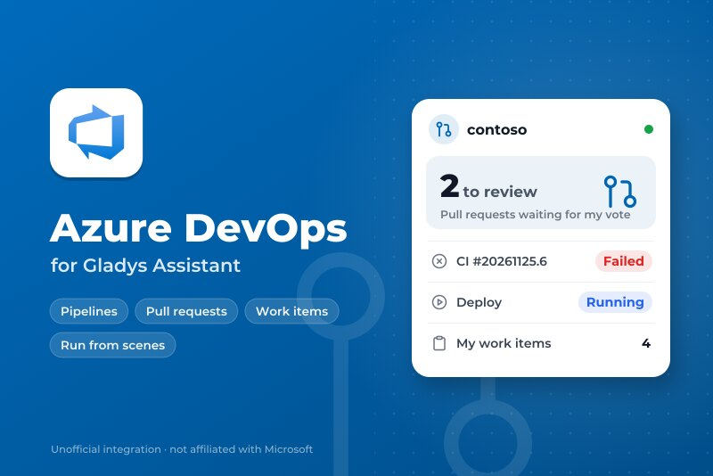
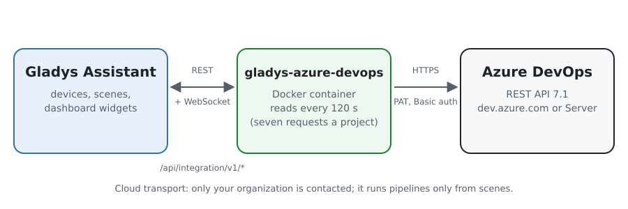
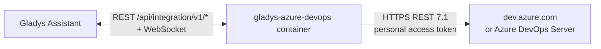
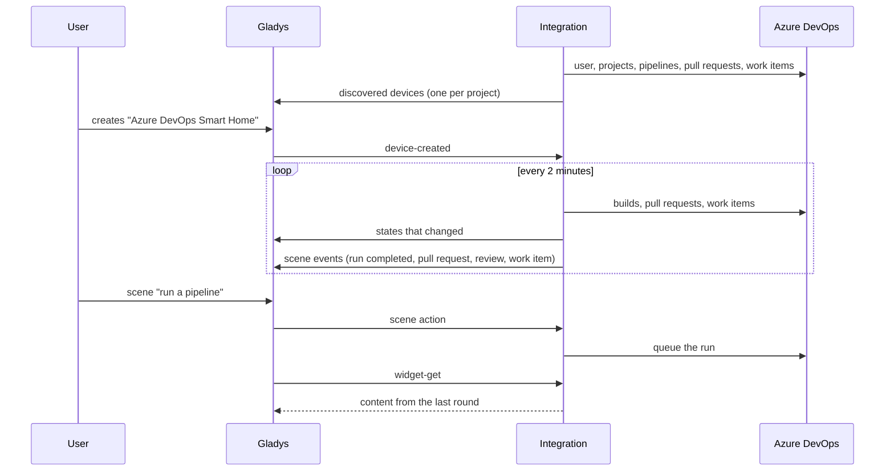
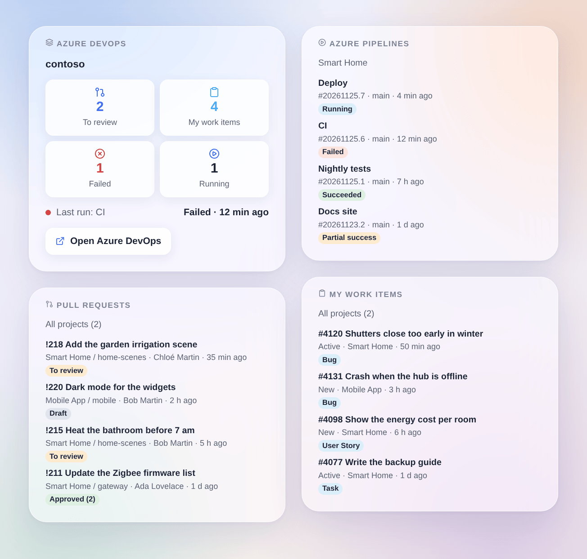

# Gladys Azure DevOps

**English** · [Français](README.fr.md) · [Deutsch](README.de.md) · [Español](README.es.md)

[](LICENSE)
[](https://github.com/William-De71/gladys-azure-devops/releases)
[](https://github.com/William-De71/gladys-azure-devops/actions/workflows/release.yml)
[](https://gladysassistant.com)



[Gladys Assistant](https://gladysassistant.com) external integration for **[Azure DevOps](https://azure.microsoft.com/products/devops)**: follow the projects of your organization in Gladys, their pipeline runs, pull requests and the work items assigned to you, in scenes and on the dashboard. It reads the official Azure DevOps REST API 7.1 with a personal access token, on Azure DevOps Services or Azure DevOps Server 2022.1 and later.

## Features

- **One device per followed project** (up to 20, every project by default): active pull requests, pull requests waiting for your vote, your open work items, failed pipelines, running builds, the last finished run and the newest pull request.
- **5 scene triggers**, **2 scene actions** and **4 dashboard widgets** (below).
- Azure DevOps Services (dev.azure.com, visualstudio.com) or an **Azure DevOps Server** collection.
- Read only, except the pipeline runs you queue from a scene. A configuration button tests the token and names the scopes it lacks.
- Four languages everywhere: English, French, German, Spanish.

## How it works





Every 2 minutes by default (60 to 3,600 seconds), the integration reads the user of the token and the projects, then each followed project with seven small requests: its pipelines with their last runs, the finished and running builds, the active and completed pull requests, and the open work items assigned to you (a WIQL query with `@Me`). Each round is compared with the previous one to fire the scene triggers; the first round is a baseline and fires nothing. A part the token may not read is left out, and its missing scope is named in the status.



### Transport

Cloud only (`"transports": ["cloud"]`): the catalog shows the cloud badge. The integration contacts the organization you set over HTTPS with your token. An Azure DevOps Server on your network is reached the same way, at its address; there is no "prefer the local connection" button.

## Devices and features

| Feature                          | Category / type          | Note                               |
| -------------------------------- | ------------------------ | ---------------------------------- |
| Active pull requests, to review  | `counter-sensor/integer` | to review: waiting for your vote   |
| My work items                    | `counter-sensor/integer` | open, assigned to the token's user |
| Failed pipelines, running builds | `counter-sensor/integer` | last run failed / in progress      |
| Last run                         | `text/text`              | `CI #20261125.6: Failed`           |
| Latest pull request              | `text/text`              | `!218 Title`                       |

`should_poll: false`: the integration reads Azure DevOps on its own timer. External ids are built on the project GUID: renaming a project keeps its device. A counter the token could not read is not published, never set to 0.

## Scene triggers, actions and widgets



**Triggers** (filter: the project device)

- **Pipeline run completed**: filters on the result, the pipeline name and the branch.
- **Pull request created**: filters on the repository and the target branch (with its `draft` flag).
- **Review requested**: a pull request now waits for your vote.
- **Pull request completed**: merged into its target branch.
- **Work item assigned to me**: filter on the type (Bug, User Story…).

Every event carries the project, the item (number, title, author or type, link) and a `summary` sentence ready for a message.

**Actions**: read a project (counters, last run, newest pull request, `summary`), and run a pipeline (by name, `folder\name` or id, on a branch or its default one; needs the Build (Read & execute) scope).

**Widgets**: **Azure DevOps** (to review, my work items, failed, running, last run, link), **Azure Pipelines** (the last run of each pipeline of a project), **Pull requests** (all, waiting for your vote, or yours) and **My work items**.

**Examples**

- When **the CI of `main` fails** → a red light in the office and a notification with the `summary`.
- When **your review is requested** → a message on your phone with the link.
- Every evening at 6 pm → **run the "Nightly tests" pipeline**, then send its run number.

## Requirements

- Gladys Assistant **5.3.0** or later (catalog keywords). Older instances cannot install the integration.
- An Azure DevOps organization, or an Azure DevOps Server **2022.1** or later collection (API 7.1).
- A personal access token with **Build (Read & execute)**, **Code (Read)**, **Work Items (Read)** and **Project and Team (Read)**.

## Installation

- **From the store** of Gladys (Integrations → External integrations), in one click, once indexed.
- **From the repository URL**: `https://github.com/William-De71/gladys-azure-devops`.
- **Developer mode**: build the image locally (`docker build -t gladys-azure-devops .`) and install it from Gladys.

## Configuration

| Field                 | Default   | Role                                                                        |
| --------------------- | --------- | --------------------------------------------------------------------------- |
| Organization          | —         | `contoso`, a dev.azure.com link, or `https://server/tfs/DefaultCollection`. |
| Personal access token | —         | The token, with the scopes above (secret).                                  |
| Projects              | all       | Names separated by commas; 20 at most.                                      |
| Refresh interval (s)  | 120       | 60 to 3,600 seconds; also the delay of the scene triggers.                  |
| Language of the texts | automatic | Device names, scene summaries and outputs.                                  |

## Usage

1. In Azure DevOps, open **User settings → Personal access tokens** and add a token for the organization with the scopes above.
2. Enter the organization, the token and, if you wish, the projects, then save; press **Test the connection**.
3. In the **Discover** tab, create the "Azure DevOps …" devices.
4. Add the **Azure DevOps**, **Azure Pipelines**, **Pull requests** and **My work items** widgets, and build scenes with the triggers above.

## Development

```bash
npm install
npm test                       # node --test, never touches the network
npm run lint && npm run format:check
npx github:GladysAssistant/integration-store . --skip-image-check
scripts/build-cover.sh         # cover.jpg from docs/assets/cover.svg
docs/illustrations/render.sh   # docs/assets/widgets.<lang>.png
node .github/scripts/release.mjs next
```

Locally, the SDK reads `GLADYS_HOST_API_URL`, `GLADYS_INTEGRATION_TOKEN` and `GLADYS_INTEGRATION_SELECTOR`; `DEBUG=gladys-integration-sdk` shows the SDK logs. The tests serve a fake organization (`test/helpers/fixtures.js`) shaped like the [REST API reference](https://learn.microsoft.com/rest/api/azure/devops/) and the answers of a public organization. The rules of the project are in [CLAUDE.md](CLAUDE.md).

## Release process


Every merge on `main` runs the CI, then computes the version from the [Conventional Commits](https://www.conventionalcommits.org/) since the last tag: `feat` → minor, `fix` / `perf` → patch, `!` or `BREAKING CHANGE` → major (a minor below 1.0.0); `docs`, `chore`, `ci`, `test`, `style`, `refactor`, `build` alone publish nothing. The changelog section is generated, the tag pushed, the multi-architecture image built, then `main` receives the release commit, the GitHub Release is created and a last job checks the public image, the store validator and the topic.

- The pull request title becomes the squash commit, then the changelog line: write it in English, for the user (`pr-title.yml` checks it). Never edit `CHANGELOG.md` by hand.
- 1.0.0 is a decision: Actions → Release → Run workflow with `release-as: 1.0.0`. `dry-run` shows the version and the notes without publishing.
- **Protected branch**: rulesets require a pull request on `main` and lock the `v*` tags; only the maintainer and deploy keys get through. The release pushes with the deploy key of the `release` environment (secret `RELEASE_DEPLOY_KEY`, `main` only): a run from another branch never gets it. `build.yml` and `github-release.yml` do not start on a tag: the release calls them, or run them by hand (Actions → Run workflow, with `version` for the image) to finish a release.
- After the first release, make the `ghcr.io` package public (Package settings → Change visibility), or Gladys cannot pull it.

## Troubleshooting

See [docs/en.md](docs/en.md#troubleshooting). Report issues with the versions of Gladys and of the integration, and the logs of the integration (never your token).

## Contributing

Issues and pull requests are welcome. Run `npm run format:check && npm run lint && npm test` before opening a pull request, and keep every external id and stored key unchanged (see [CLAUDE.md](CLAUDE.md)).

## Security

See [SECURITY.md](SECURITY.md): report vulnerabilities privately. The token is a `secret` field of Gladys, sent only to the organization you set, in a Basic header over HTTPS, and never written to the logs. Give it only the scopes above: without Build (Read & execute), the integration cannot start anything. It runs as a non-root user, in its container.

## Screenshots to come

The images above are illustrations, not screenshots. Real screenshots will go in `docs/assets/screenshots/` (PNG, 1280 × 800): `configuration.png`, `discovery.png`, `device.png`, `scene.png`.

## License

[Apache License 2.0](LICENSE) — see also [NOTICE](NOTICE). Azure DevOps is a trademark of the Microsoft group of companies; this integration is not affiliated with Microsoft. Thanks to the Gladys documentation and SDK, and to Microsoft for the Azure DevOps REST API reference.
