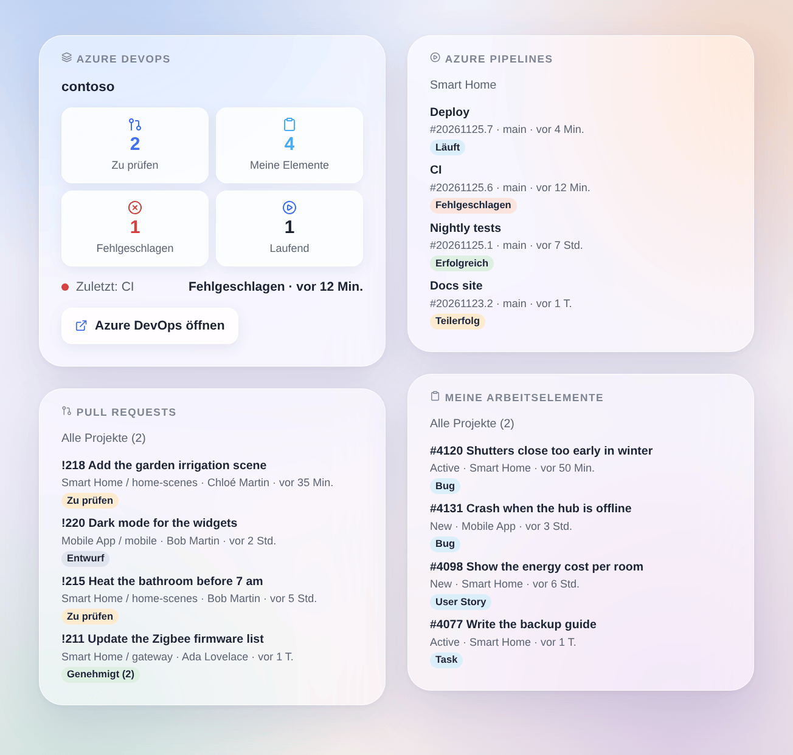

# Azure DevOps

## Überblick

Diese Integration verfolgt die Projekte einer **Azure-DevOps**-Organisation in Gladys: Pipeline-Ausführungen, Pull Requests und die dir zugewiesenen Arbeitselemente werden zu Geräten, Szenenauslösern und Dashboard-Widgets. Sie liest die offizielle REST-API von Azure DevOps (Version 7.1) mit einem persönlichen Zugriffstoken, auf Azure DevOps Services (dev.azure.com) oder Azure DevOps Server 2022.1 und neuer. Sie schreibt nichts, außer den Ausführungen, die du mit der Szenenaktion **Pipeline starten** einreihst.

Jedes verfolgte Projekt wird ein Gerät. Die Szenenauslöser reagieren auf eine beendete Pipeline-Ausführung, einen neuen Pull Request, ein von dir erwartetes Review, einen abgeschlossenen Pull Request und ein dir zugewiesenes Arbeitselement.

Azure DevOps ist eine Marke der Microsoft-Unternehmensgruppe. Diese Integration steht in keiner Verbindung zu Microsoft.

## Voraussetzungen

- Gladys Assistant 5.3.0 oder neuer.
- Eine Azure-DevOps-Organisation (oder eine Sammlung von Azure DevOps Server 2022.1).
- Ein persönliches Zugriffstoken: Öffne in Azure DevOps **Benutzereinstellungen → Persönliche Zugriffstoken**, füge ein Token für diese Organisation hinzu, wähle **Custom defined** und hake **Build (Read & execute)**, **Code (Read)**, **Work Items (Read)** und **Project and Team (Read)** an. **Build (Read)** reicht, wenn du nie Pipelines aus Szenen startest. Merke dir das Ablaufdatum.

## Konfiguration

| Feld                       | Aufgabe                                                                                   |
| -------------------------- | ----------------------------------------------------------------------------------------- |
| Organisation               | Ihr Name (`contoso`), ihr Link oder die Adresse einer Azure-DevOps-Server-Sammlung.       |
| Persönliches Zugriffstoken | Das Token, mit den oben genannten Bereichen.                                              |
| Projekte                   | Namen durch Kommas getrennt (höchstens 20); leer: alle Projekte, die ersten 20 nach Name. |
| Abfrageintervall (s)       | 60 bis 3.600 Sekunden, Standard 120; auch die Reaktionszeit der Szenenauslöser.           |
| Sprache der Texte          | Gerätenamen, Zusammenfassungen und Ausgaben der Szenen; standardmäßig automatisch.        |

Speichere und drücke dann **Verbindung testen**: sie nennt den Benutzer des Tokens, die Zahl der gelesenen Projekte und die Bereiche, die dem Token fehlen.

## Verwendung

### Geräte

Erstelle unter **Erkennung** ein Gerät „Azure DevOps Projekt“ pro Projekt: aktive Pull Requests, Pull Requests, die auf deine Stimme warten, deine offenen Arbeitselemente, Pipelines mit fehlgeschlagener letzter Ausführung, laufende Builds, die letzte beendete Ausführung („CI #20261125.6: Fehlgeschlagen“) und der neueste Pull Request. Ein Zähler, den das Token nicht lesen darf, wird weggelassen, nie auf 0 gesetzt.

### Szenenauslöser

Alle filtern nach Projekt (leer für jedes):

- **Pipeline-Ausführung beendet**: Filter nach Ergebnis (erfolgreich, teilweise erfolgreich, fehlgeschlagen, abgebrochen), Pipeline-Name und Branch (`main`; ein Pull-Request-Build heißt `PR 12`).
- **Pull Request erstellt**: Filter nach Repository und Zielbranch (Variable `draft`).
- **Review angefordert**: ein Pull Request wartet auf deine Stimme (du bist Reviewer, hast nicht abgestimmt, kein Entwurf).
- **Pull Request abgeschlossen**: in seinen Zielbranch gemergt.
- **Arbeitselement zugewiesen**: Filter nach Typ (Bug, User Story, Task…).

Jedes Ereignis liefert das Projekt, das Element (Nummer, Titel, Autor oder Typ, Link) und einen Satz `summary`. Die erste Abfrage nach einem Start oder einem neuen Token ist eine Referenz: nichts wird ausgelöst.

### Szenenaktionen

- **Projekt lesen** liefert seine Zähler, die letzte Ausführung, den neuesten Pull Request und einen Satz `summary`. Ein unbekannter Zähler ist -1.
- **Pipeline starten** reiht eine Ausführung einer Pipeline ein, nach Name, `Ordner\Name` oder ID, auf einem Branch oder ihrem Standardbranch. Jeder Aufruf reiht eine weitere ein: starte sie nicht aus dem Auslöser „Pipeline-Ausführung beendet“ derselben Pipeline.

### Widgets

- **Azure DevOps**: zu prüfende Pull Requests, meine Elemente, fehlgeschlagene Pipelines und laufende Builds, eines Projekts oder aller, mit der letzten Ausführung und einem Link.
- **Azure Pipelines**: die Pipelines eines Projekts und das Ergebnis ihrer letzten Ausführung.
- **Pull Requests**: die aktiven Pull Requests, alle, die auf deine Stimme warten, oder deine.
- **Meine Arbeitselemente**: die dir zugewiesenen offenen Arbeitselemente, zuletzt geänderte zuerst.

## Fehlerbehebung

- **„Azure DevOps hat das Token abgelehnt“**: das Token ist falsch, abgelaufen, widerrufen oder für eine andere Organisation erstellt: erstelle ein neues.
- **„Das Token kann die Projekte nicht auflisten“**: füge den Bereich **Project and Team (Read)** hinzu.
- **„Fehlende Bereiche im Token“**: die genannten Teile (Pipelines, Pull Requests, Arbeitselemente) fehlen, bis du den Bereich hinzufügst.
- **„Keine Azure-DevOps-Organisation unter…“**: prüfe das Feld Organisation; für Azure DevOps Server gib die Adresse der Sammlung an, Version 2022.1 oder neuer.
- **„Nicht gefunden“**: prüfe die Projektnamen (wie in Azure DevOps angezeigt).
- Melde ein Problem mit den Versionen von Gladys und der Integration und ihren Protokollen; füge nie dein Token ein.
