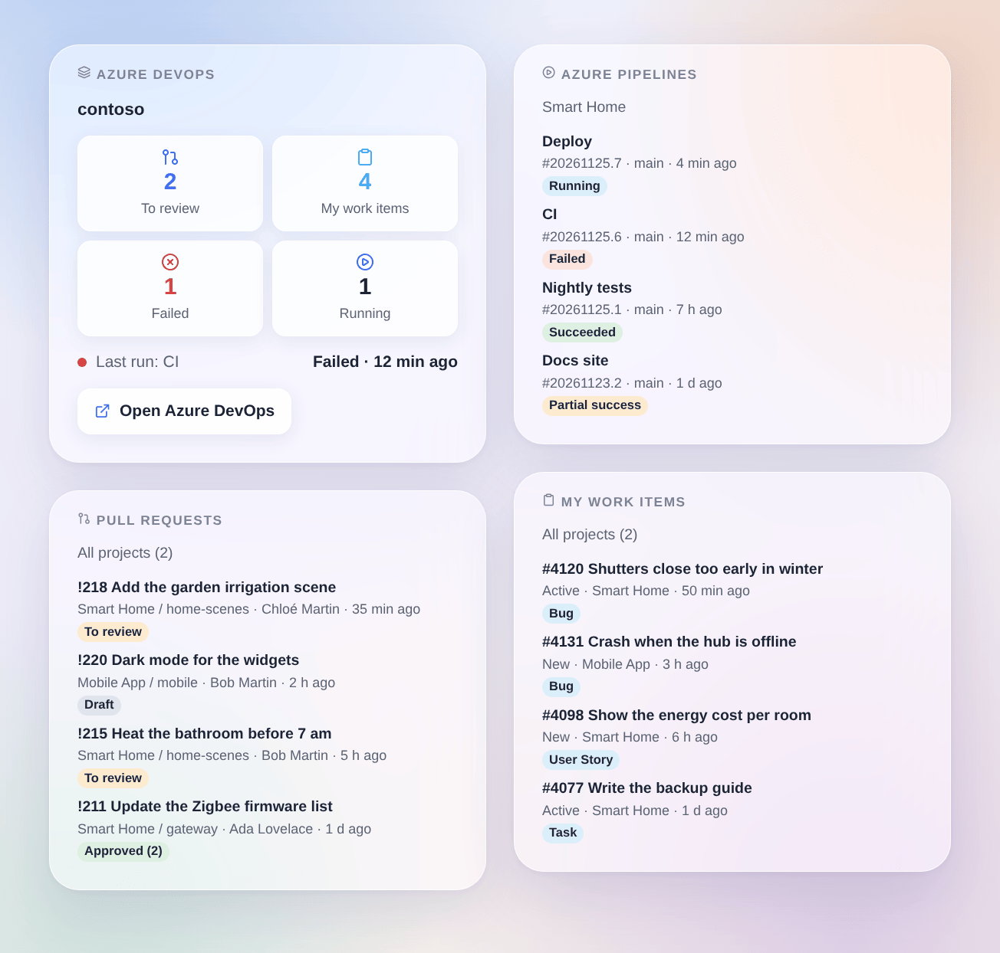

# Azure DevOps

## Overview

This integration follows the projects of an **Azure DevOps** organization in Gladys: pipeline runs, pull requests and the work items assigned to you become devices, scene triggers and dashboard widgets. It reads the official Azure DevOps REST API 7.1 with a personal access token, on Azure DevOps Services (dev.azure.com) or Azure DevOps Server 2022.1 and later. It writes nothing, except the runs you queue with the **Run a pipeline** scene action.

Each followed project becomes a device. Scene triggers react to a finished pipeline run, a new pull request, a review requested from you, a completed pull request and a work item assigned to you.

Azure DevOps is a trademark of the Microsoft group of companies. This integration is not affiliated with Microsoft.

## Requirements

- Gladys Assistant 5.3.0 or later.
- An Azure DevOps organization (or an Azure DevOps Server 2022.1 collection).
- A personal access token: in Azure DevOps, open **User settings → Personal access tokens**, add a token for this organization, choose **Custom defined** and tick **Build (Read & execute)**, **Code (Read)**, **Work Items (Read)** and **Project and Team (Read)**. **Build (Read)** is enough if you never run pipelines from scenes. Note its expiry date.

## Configuration

| Field                 | Role                                                                                 |
| --------------------- | ------------------------------------------------------------------------------------ |
| Organization          | Its name (`contoso`), its link, or the address of an Azure DevOps Server collection. |
| Personal access token | The token, with the scopes above.                                                    |
| Projects              | Names separated by commas (20 at most); empty: every project, the first 20 by name.  |
| Refresh interval (s)  | 60 to 3,600 seconds, 120 by default; also the delay of the scene triggers.           |
| Language of the texts | Device names, scene summaries and outputs; automatic by default.                     |

Save, then press **Test the connection**: it names the user of the token, says how many projects were read, and lists the scopes the token is missing.

## Usage

### Devices

In **Discover**, create one "Azure DevOps project" device per project: active pull requests, pull requests waiting for your vote, your open work items, pipelines whose last run failed, running builds, the last finished run ("CI #20261125.6: Failed") and the newest pull request. A counter the token may not read is left out, never set to 0.

### Scene triggers

All of them filter by project (leave empty for any):

- **Pipeline run completed**: filters on the result (succeeded, partially succeeded, failed, canceled), the pipeline name and the branch (`main`; a pull request build shows as `PR 12`).
- **Pull request created**: filters on the repository and the target branch (variable `draft`).
- **Review requested**: a pull request now waits for your vote (you are a reviewer, you have not voted, it is not a draft).
- **Pull request completed**: merged into its target branch.
- **Work item assigned to me**: filter on the type (Bug, User Story, Task…).

Every event gives the project, the item (number, title, author or type, link) and a `summary` sentence. The first reading after a start or a new token is a baseline: nothing fires.

### Scene actions

- **Read a project** gives its counters, last run and newest pull request, and a `summary` sentence. An unknown counter is -1.
- **Run a pipeline** queues one run of a pipeline, by name, `folder\name` or id, on a branch or its default one. Each call queues one more run: do not start it from the "Pipeline run completed" trigger of the same pipeline.

### Widgets

- **Azure DevOps**: pull requests to review, my work items, failed pipelines and running builds, of one project or all, with the last run and a link.
- **Azure Pipelines**: the pipelines of a project and the result of their last run.
- **Pull requests**: the active pull requests, all of them, those waiting for your vote, or yours.
- **My work items**: the open work items assigned to you, last changed first.

## Troubleshooting

- **"Azure DevOps refused the token"**: the token is wrong, expired, revoked, or created for another organization: create a new one.
- **"The token cannot list the projects"**: add the **Project and Team (Read)** scope.
- **"Scopes missing on the token"**: the named parts (pipelines, pull requests, work items) are left out until you add the scope.
- **"No Azure DevOps organization at…"**: check the Organization field; for Azure DevOps Server, give the address of the collection, version 2022.1 or later.
- **"Not found"**: check the project names (as shown in Azure DevOps).
- Report a problem with the versions of Gladys and of the integration and its logs; never paste your token.
