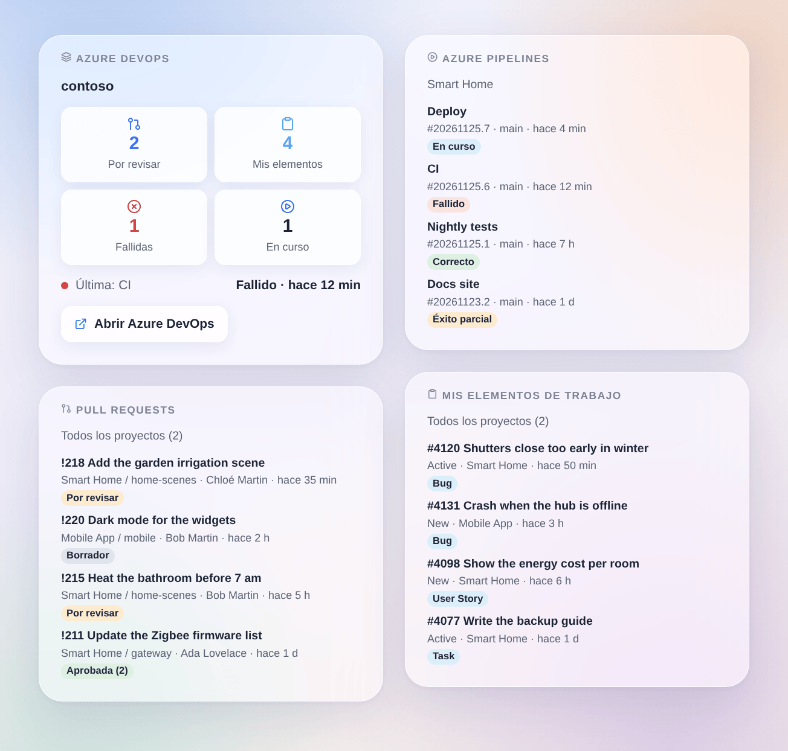

# Azure DevOps

## Presentación

Esta integración sigue en Gladys los proyectos de una organización de **Azure DevOps**: las ejecuciones de pipelines, las pull requests y los elementos de trabajo que tiene asignados se convierten en dispositivos, disparadores de escena y widgets del panel. Lee la API REST oficial de Azure DevOps (versión 7.1) con un token de acceso personal, en Azure DevOps Services (dev.azure.com) o Azure DevOps Server 2022.1 y posteriores. No escribe nada, salvo las ejecuciones que ponga en cola con la acción de escena **Ejecutar una pipeline**.

Cada proyecto seguido se convierte en un dispositivo. Los disparadores de escena reaccionan a una ejecución de pipeline terminada, una nueva pull request, una revisión que se le solicita, una pull request completada y un elemento de trabajo que se le asigna.

Azure DevOps es una marca del grupo de empresas Microsoft. Esta integración no está afiliada a Microsoft.

## Requisitos

- Gladys Assistant 5.3.0 o posterior.
- Una organización de Azure DevOps (o una colección de Azure DevOps Server 2022.1).
- Un token de acceso personal: en Azure DevOps, abra **Configuración de usuario → Tokens de acceso personal**, añada un token para esta organización, elija **Custom defined** y marque **Build (Read & execute)**, **Code (Read)**, **Work Items (Read)** y **Project and Team (Read)**. Basta con **Build (Read)** si nunca lanza pipelines desde las escenas. Anote su fecha de caducidad.

## Configuración

| Campo                    | Función                                                                                    |
| ------------------------ | ------------------------------------------------------------------------------------------ |
| Organización             | Su nombre (`contoso`), su enlace o la dirección de una colección de Azure DevOps Server.   |
| Token de acceso personal | El token, con los ámbitos indicados arriba.                                                |
| Proyectos                | Nombres separados por comas (20 como máximo); vacío: todos los proyectos, los 20 primeros. |
| Intervalo de lectura (s) | De 60 a 3600 segundos, 120 por defecto; también el retardo de los disparadores de escena.  |
| Idioma de los textos     | Nombres de los dispositivos, resúmenes y salidas de las escenas; automático por defecto.   |

Guarde y pulse **Probar la conexión**: indica el usuario del token, cuántos proyectos se han leído y los ámbitos que le faltan al token.

## Uso

### Dispositivos

En **Descubrimiento**, cree un dispositivo «Azure DevOps proyecto» por proyecto: pull requests activas, pull requests que esperan su voto, sus elementos de trabajo abiertos, pipelines cuya última ejecución ha fallado, builds en curso, la última ejecución terminada («CI #20261125.6: Fallido») y la pull request más reciente. Un contador que el token no puede leer se omite, nunca se pone a 0.

### Disparadores de escena

Todos filtran por proyecto (vacío para cualquiera):

- **Ejecución de pipeline terminada**: filtros por resultado (correcto, correcto en parte, fallido, cancelado), nombre de la pipeline y rama (`main`; la build de una pull request aparece como `PR 12`).
- **Pull request creada**: filtros por repositorio y rama de destino (variable `draft`).
- **Revisión solicitada**: una pull request espera su voto (es revisor, no ha votado, no es un borrador).
- **Pull request completada**: fusionada en su rama de destino.
- **Elemento de trabajo asignado**: filtro por tipo (Bug, User Story, Task…).

Cada evento da el proyecto, el elemento (número, título, autor o tipo, enlace) y una frase `summary`. La primera lectura tras un arranque o un nuevo token sirve de referencia: no se dispara nada.

### Acciones de escena

- **Leer un proyecto** da sus contadores, su última ejecución, su pull request más reciente y una frase `summary`. Un contador desconocido vale -1.
- **Ejecutar una pipeline** pone en cola una ejecución de una pipeline, por nombre, `carpeta\nombre` o identificador, en una rama o en su rama por defecto. Cada llamada añade otra: no la lance desde el disparador «Ejecución de pipeline terminada» de la misma pipeline.

### Widgets

- **Azure DevOps**: pull requests por revisar, mis elementos, pipelines fallidas y builds en curso, de un proyecto o de todos, con la última ejecución y un enlace.
- **Azure Pipelines**: las pipelines de un proyecto y el resultado de su última ejecución.
- **Pull requests**: las pull requests activas, todas, las que esperan su voto o las suyas.
- **Mis elementos de trabajo**: los elementos de trabajo abiertos que tiene asignados, los últimos modificados primero.

## Solución de problemas

- **«Azure DevOps rechazó el token»**: el token es incorrecto, ha caducado, se ha revocado o se creó para otra organización: cree uno nuevo.
- **«El token no puede listar los proyectos»**: añada el ámbito **Project and Team (Read)**.
- **«Ámbitos que faltan en el token»**: las partes indicadas (pipelines, pull requests, elementos de trabajo) se omiten hasta que añada el ámbito.
- **«No hay ninguna organización de Azure DevOps en…»**: compruebe el campo Organización; para Azure DevOps Server, indique la dirección de la colección, versión 2022.1 o posterior.
- **«No encontrados»**: compruebe los nombres de los proyectos (tal como aparecen en Azure DevOps).
- Informe de un problema con las versiones de Gladys y de la integración y sus registros; no pegue nunca su token.
