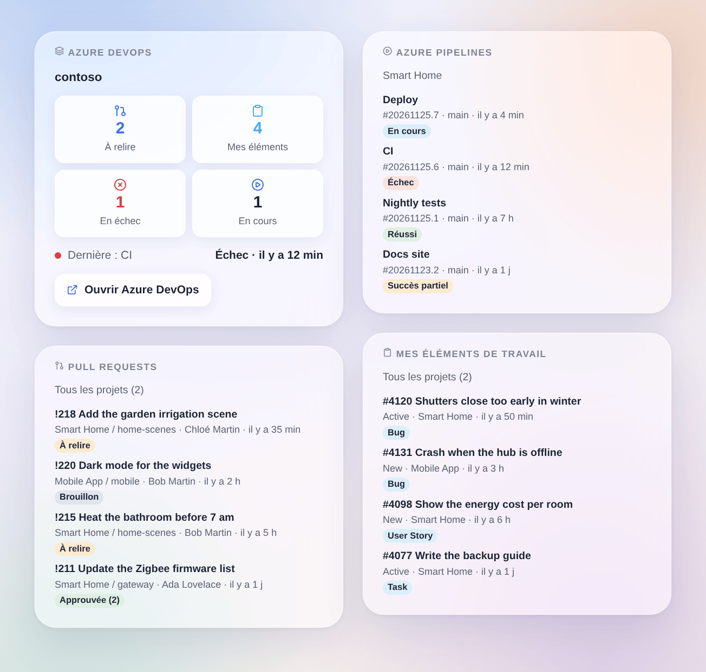

# Azure DevOps

## Présentation

Cette intégration suit dans Gladys les projets d’une organisation **Azure DevOps** : exécutions de pipelines, pull requests et éléments de travail qui vous sont assignés deviennent des appareils, des déclencheurs de scène et des widgets de tableau de bord. Elle lit l’API REST officielle d’Azure DevOps (version 7.1) avec un jeton d’accès personnel, sur Azure DevOps Services (dev.azure.com) ou Azure DevOps Server 2022.1 et plus récent. Elle n’écrit rien, sauf les exécutions que vous lancez avec l’action de scène **Lancer un pipeline**.

Chaque projet suivi devient un appareil. Les déclencheurs de scène réagissent à une exécution de pipeline terminée, une nouvelle pull request, une relecture qui vous est demandée, une pull request terminée et un élément de travail qui vous est assigné.

Azure DevOps est une marque du groupe Microsoft. Cette intégration n’est pas affiliée à Microsoft.

## Prérequis

- Gladys Assistant 5.3.0 ou plus récent.
- Une organisation Azure DevOps (ou une collection Azure DevOps Server 2022.1).
- Un jeton d’accès personnel : dans Azure DevOps, ouvrez **Paramètres utilisateur → Jetons d’accès personnels**, ajoutez un jeton pour cette organisation, choisissez **Custom defined** et cochez **Build (Read & execute)**, **Code (Read)**, **Work Items (Read)** et **Project and Team (Read)**. **Build (Read)** suffit si vous ne lancez jamais de pipeline depuis les scènes. Notez sa date d’expiration.

## Configuration

| Champ                     | Rôle                                                                                           |
| ------------------------- | ---------------------------------------------------------------------------------------------- |
| Organisation              | Son nom (`contoso`), son lien, ou l’adresse d’une collection Azure DevOps Server.              |
| Jeton d’accès personnel   | Le jeton, avec les étendues ci-dessus.                                                         |
| Projets                   | Noms séparés par des virgules (20 au plus) ; vide : tous les projets, les 20 premiers par nom. |
| Intervalle de lecture (s) | De 60 à 3 600 secondes, 120 par défaut ; c’est aussi le délai des déclencheurs de scène.       |
| Langue des textes         | Noms des appareils, résumés et sorties des scènes ; automatique par défaut.                    |

Enregistrez, puis appuyez sur **Tester la connexion** : elle donne l’utilisateur du jeton, le nombre de projets lus et les étendues qui manquent au jeton.

## Utilisation

### Appareils

Dans **Découverte**, créez un appareil « Azure DevOps projet » par projet : pull requests actives, pull requests en attente de votre vote, vos éléments de travail ouverts, pipelines dont la dernière exécution a échoué, builds en cours, la dernière exécution terminée (« CI #20261125.6: Échec ») et la pull request la plus récente. Un compteur que le jeton ne peut pas lire est omis, jamais mis à 0.

### Déclencheurs de scène

Tous filtrent par projet (vide pour tous) :

- **Exécution de pipeline terminée** : filtres sur le résultat (réussi, réussi en partie, échec, annulé), le nom du pipeline et la branche (`main` ; le build d’une pull request s’affiche `PR 12`).
- **Pull request créée** : filtres sur le dépôt et la branche cible (variable `draft`).
- **Relecture demandée** : une pull request attend votre vote (vous êtes relecteur, vous n’avez pas voté, ce n’est pas un brouillon).
- **Pull request terminée** : fusionnée dans sa branche cible.
- **Élément de travail assigné** : filtre sur le type (Bug, User Story, Task…).

Chaque événement donne le projet, l’élément (numéro, titre, auteur ou type, lien) et une phrase `summary`. La première lecture après un démarrage ou un nouveau jeton sert de référence : rien ne se déclenche.

### Actions de scène

- **Lire un projet** donne ses compteurs, sa dernière exécution, sa pull request la plus récente et une phrase `summary`. Un compteur inconnu vaut -1.
- **Lancer un pipeline** met en file une exécution d’un pipeline, par nom, `dossier\nom` ou identifiant, sur une branche ou sa branche par défaut. Chaque appel en ajoute une : ne le lancez pas depuis le déclencheur « Exécution de pipeline terminée » du même pipeline.

### Widgets

- **Azure DevOps** : pull requests à relire, mes éléments, pipelines en échec et builds en cours, d’un projet ou de tous, avec la dernière exécution et un lien.
- **Azure Pipelines** : les pipelines d’un projet et le résultat de leur dernière exécution.
- **Pull requests** : les pull requests actives, toutes, celles qui attendent votre vote, ou les vôtres.
- **Mes éléments de travail** : les éléments de travail ouverts qui vous sont assignés, derniers modifiés d’abord.

## Dépannage

- **« Azure DevOps a refusé le jeton »** : le jeton est faux, expiré, révoqué ou créé pour une autre organisation : créez-en un nouveau.
- **« Le jeton ne peut pas lister les projets »** : ajoutez l’étendue **Project and Team (Read)**.
- **« Étendues absentes du jeton »** : les parties nommées (pipelines, pull requests, éléments de travail) sont omises jusqu’à l’ajout de l’étendue.
- **« Aucune organisation Azure DevOps à… »** : vérifiez le champ Organisation ; pour Azure DevOps Server, donnez l’adresse de la collection, version 2022.1 ou plus récente.
- **« Introuvables »** : vérifiez les noms des projets (tels qu’affichés dans Azure DevOps).
- Signalez un problème avec les versions de Gladys et de l’intégration et ses journaux ; ne collez jamais votre jeton.
